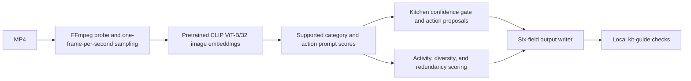

# Track 04 technical defense | Team VIT

This note explains the shipped system and the decisions behind it. The [AI disclosure](AI_DISCLOSURE.md) records assistance used during development. Team VIT remains responsible for the submitted behavior and claims.

## Problem and contract

The input is a first-person MP4. `./run.sh <video.mp4> <out.json>` emits exactly six fields: `team_id`, `video_id`, `duration_sec`, `label`, `actions`, and `highlights`. Class names come from the supplied `supported_classes.json`. Action intervals and highlight intervals use seconds. The output must stay within the video, use chronological non-overlapping highlights, and keep selected footage within 15% of the source. The implementation aims for 14.5% to leave a rounding margin. A highlight must last at least four seconds where the two constraints can both hold.

## Architecture and design choices



FFmpeg resizes with aspect ratio preserved and pads frames to 224 by 224. The model is the pinned local CLIP ViT-B/32 checkpoint; `run.sh` sets Hugging Face offline mode. The default package uses CLIP. The optional kitchen TSM recognizer is not in that package. The gate prevents the generic route from asserting kitchen actions when scene confidence is low. A non-kitchen or uncertain video may therefore have an empty `actions` array and still receive a label and highlights.

The selector ranks candidate intervals using predicted activity, distinct action-pair evidence and a visual similarity penalty. It favors varied interaction time under the fixed budget. An independent offline candidate that used more of the 14.5% budget improved a local coverage proxy on five reused training clips, but it was not shipped: highlight F1 on FPVSum and a fresh independent holdout were not measured. The existing selector remains frozen.

## Verification and decision record

| Decision or risk | Evidence checked on 21 Nov 2026 | Current decision |
| --- | --- | --- |
| Schema and manifest accounting | Local checker read 82 JSON files: 82 valid, zero file errors or warnings, 103 eligible outputs absent, two organizer exclusions. It exits 1 for incomplete coverage. | Report 82/185, never a complete manifest or official validation. |
| End-to-end demo | The exact `run.sh` command on P01_12 exited 0, wrote 67 action proposals and six highlights totaling 24.00 of 173.81 seconds, and rendered a 23.99-second reel. The JSON is byte-identical to the preserved output and passed the local single-video check. | Show this genuine run; call the actions proposals, not verified matches. |
| Output edge cases | Six submission-check tests, eight hardening tests, two scene-routing tests and six golden-output tests passed in the project venv. | Keep the tested writer and runner. |
| Corrupt or unreadable media | Runner probes/decodes before inference; existing failure test expects nonzero and no fabricated JSON. | Preserve the failure rather than invent an observation. |
| Renamed input or path with spaces | Earlier real-media comparison found identical predictions and timestamps when only the filename changed. | `video_id` comes from the output filename; content drives predictions. |
| Recovered partial sources | P07_18 and P26_38 passed source verification, full decode, inference and local validation after recovery. | Count only verified completed outputs. |
| Four-second rule versus 15% cap | P03_26, P26_30 and P28_23 have durations below 26.67 seconds. | Leave these absent pending organizer clarification; no invented exception. |
| Model checkpoint delivery | Local 605,247,071-byte file is in the 82-output ZIP. Fresh GitHub LFS pull previously timed out; a hash-checked pinned recovery was tested. | Document recovery; do not claim LFS clone is proven reliable. |

The 82 valid files show format and timing compliance of those outputs. They do **not** establish 82 accurate action predictions. Earlier small local recognition comparisons found substantial verb–noun mistakes, and the default CLIP route sees sampled still frames, so brief motions and interactions at frame edges can be missed. Historical comparisons that used videos now in the manifest are not clean held-out estimates. No Samsung action mAP, coverage, highlight F1, label accuracy or overall score is available.

## Relevant failure and safety boundaries

- The video and its path are untrusted input. The runner never executes instructions embedded in frames, audio, filenames or metadata. The model is a visual scorer, not a language agent with a prompt-instruction channel. The path is passed as an argument to FFmpeg, and a failed probe/decode does not create a placeholder prediction.
- The local checker rejects malformed JSON, duplicate keys, unsupported classes, nonfinite scores, timestamps outside the duration, overlapping highlights and budget violations. A missing manifest entry remains missing in its report.
- No public or hidden challenge evaluation annotations are used to choose predictions. Raw source videos and temporary caches remain outside Git. A public demo should use footage cleared for sharing.
- The system does not promise accurate action recognition on arbitrary domains, adversarial edits, multilingual audio or sensitive scenes. It does not transcribe audio. Unsupported or uncertain actions may be omitted.

## Reproduce the claims

From the repository root, after installing `requirements.txt` and recovering the verified local checkpoint:

```sh
./run.sh work/fresh-comparison/P01_12.mp4 work/final-2026/demo-recording/P01_12.json --demo work/final-2026/demo-recording
python code/check_output.py work/fresh-comparison/P01_12.mp4 work/final-2026/demo-recording/P01_12.json
python code/check_output.py --dir outputs --manifest kit/manifest.csv --team-id VIT --report work/final-2026/validation-current.json
```

The final command exits 1 because 103 eligible outputs are missing; inspect its report for the 82 locally valid files. The demo source is local and is not part of the public repository. The [demo script](demo_script.md) gives the recording sequence.
