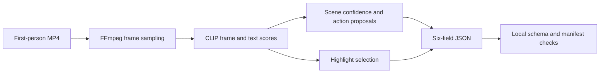

# Track 04 slide outline

1. VIT | Vellore Institute of Technology, Vellore | Samsung PRISM XR Hackathon 2026 | Solo entry. Add the registered member details before sharing.
2. Problem. First-person recordings bury meaningful interactions among idle and repeated footage. Return useful moments and timestamps within a fixed viewing budget.
3. Solution. Score sampled frames offline with pretrained CLIP, classify the scene, localize supported actions, and rank distinct interaction segments.
4. Architecture.

5. Track output. Show a real VIT JSON and its corresponding reel. Explain that scores are uncalibrated model signals.
6. Differentiation. Selection rewards diverse predicted interactions and discounts similar clips. The scene gate avoids imposing kitchen actions on uncertain footage.
7. Demo and setup. Show the two-argument runner and local checker. Report 78 of 185 eligible videos locally valid, 102 missing sources, one failed source and two excluded. Official validation remains unavailable.
8. Limitations. CLIP observes individual sampled frames and struggles with motion and exact verb–noun pairs. Historical temporal comparisons overlap the manifest. The four-second rule conflicts with the budget on three clips.
9. Thank you.
